# HexaBlock Suite

<!-- Badges: added when CI is set up (build status, tests, coverage). -->


> **Status:** iteration I0 (foundations). The Expo app with strict TypeScript,
> ESLint, Prettier, Jest and commit hooks is in place; the generic engine starts
> in I1. See [`docs/implementation-plan.md`](./docs/implementation-plan.md).

## Description

HexaBlock Suite is a mobile app (React Native + TypeScript) with four casual
puzzle games on hexagonal boards — **Hexa Lines**, **Hexa Fit**,
**Hexa Sort** and **Hexa Merge** — built on **a single generic engine**. Each
game is a variant that plugs its own rules into the engine instead of
duplicating the board, rendering, persistence or game flow.

The repository also contains the **admin web panel** (`admin/`), where levels
are designed and validated with the same domain code as the game.

Accounts, progress sync, leaderboards and level content are served by the
[backend](https://github.com/PepeTza/hexablock-backend) (NestJS + PostgreSQL).

## Demo / Screenshots

_Coming soon: screenshots or GIFs of the four variants._

## Architecture

The client follows Clean Architecture with four layers. Arrows show code
dependencies pointing toward application and domain. See
[`docs/architecture.md`](./docs/architecture.md) and the
[diagram sources](./docs/diagrams/README.md).


## Generic Engine

_Coming soon._ Generic types of the engine (`Board<TCell>`,
`GameEngine<TCell, TMove, TState>`, bounded generics such as
`TTile extends IMergeable<TTile>`), their constraints and how each variant
instantiates them. See [`docs/EXTENSIBILITY.md`](./docs/EXTENSIBILITY.md).



## Design Patterns

_Coming soon:_ table of the patterns implemented, with a short description and
a link to the code.

## SOLID Principles

_Coming soon:_ how each principle is applied, with code examples.

## AOP

_Coming soon:_ aspects implemented (logging, security, error handling with
retries, caching) and the decorator-based strategy used.

## Getting Started

Prerequisites: Node.js 22.13 or newer, and an Android phone with the Expo Go
app or an Android emulator.

```bash
npm install     # installs dependencies and activates the git hooks
npm start       # starts Expo; scan the QR code with Expo Go
npm run android # starts Expo and opens an Android emulator or device
```

### Admin panel

The admin web panel lives in [`admin/`](./admin): a separate Vite + React app
(D-18) with its own `package.json`. It reuses the game's domain and
application layers through the `@domain` and `@application` aliases (D-19),
and a lint rule forbids it from importing anything else of the app.

```bash
cd admin
npm install     # installs the panel's dependencies
npm run dev     # serves the panel at http://localhost:5173
npm run build   # type-checks and builds it into admin/dist
npm run preview # serves the built panel
```

Set `VITE_API_URL` to the backend API base URL (including `/api/v1`) when
serving the panel and API from different origins. The backend must allow the
panel origin. Sign in with an administrator account. The panel keeps the
session in memory and signs out when the page is reloaded.

## Running Tests

```bash
npm test               # unit and UI tests
npm run test:coverage  # same, with the 80 % coverage threshold
npm run lint           # ESLint
npm run format:check   # Prettier
npm run typecheck      # TypeScript strict mode
```

Admin panel, from `admin/`:

```bash
npm test               # Vitest: the page and the import boundary rule
npm run lint           # ESLint, including the import boundary
npm run typecheck      # TypeScript strict mode
```

## AI Usage Documentation

See [`AI_USAGE.md`](./AI_USAGE.md). AI agents follow [`AGENTS.md`](./AGENTS.md)
and the [`harness/`](./harness/README.md).

## References

External sources of algorithms and ideas. We reimplement them; we do not copy
their code. Each one is also cited in a comment in the file that uses it.

| Source | What we took | Where |
|---|---|---|
| Red Blob Games, ["Hexagonal Grids"](https://www.redblobgames.com/grids/hexagons/) | Axial and cube coordinates; neighbours, rings and 60° rotation | `src/domain/engine/hex/hex-coord.ts`, `hex-geometry.ts` |
| OEIS, [A006534](https://oeis.org/A006534) (one-sided polyhexes) | The number of piece shapes of 1 to 5 cells (1, 1, 3, 10, 33), used to check the catalog is complete | `src/domain/engine/hex/hex-piece-catalog.test.ts`, `docs/piece-catalog.md` |
| Tommy Ettinger, [`mulberry32`](https://gist.github.com/tommyettinger/46a874533244883189141785d1235295) (2017, public domain; see also [bryc's PRNG notes](https://github.com/bryc/code/blob/master/jshash/PRNGs.md#mulberry32)) | 32-bit seeded pseudo-random number generator algorithm | `src/domain/engine/random/seeded-random.ts` |
| WHATWG, [DOM Standard, "inner invoke"](https://dom.spec.whatwg.org/#concept-event-listener-inner-invoke) | A listener that throws has its error reported while the other listeners still run | `src/domain/engine/game/game-engine.ts` |
| TypeScript, [2.6 release notes, "Strict function types"](https://www.typescriptlang.org/docs/handbook/release-notes/typescript-2-6.html) | Function-typed properties are checked contravariantly, methods bivariantly; why `IGameSession.applyMove` is a property | `src/domain/engine/game/variant-factory.ts` |

### Third-party assets

Credits and licences of sounds, fonts and images (RNF-12). None yet.

| Asset | Author | Licence | Where |
|---|---|---|---|

## Contributing

See [`CONTRIBUTING.md`](./CONTRIBUTING.md): Conventional Commits, branch
workflow (GitHub Flow, protected `main`) and pull request process.

## License

[MIT](./LICENSE)
