# HexaBlock Suite

<!-- Badges: added when CI is set up (build status, tests, coverage). -->


> **Status:** iteration I0 (foundations). The Expo app with strict TypeScript,
> ESLint, Prettier, Jest and commit hooks is in place; the generic engine starts
> in I1. See [`docs/implementation-plan.md`](./docs/implementation-plan.md).

## Description

HexaBlock Suite is a mobile app (React Native + TypeScript) with four casual
puzzle games on hexagonal boards — **Hexa Lines**, **Hexa Fit**,
**Hexa Sort** and **Hexa Merge** — built on **a single generic engine**. Each
game is a variant that plugs its own rules into the engine instead of
duplicating the board, rendering, persistence or game flow.

The repository also contains the **admin web panel** (`admin/`), where levels
are designed and validated with the same domain code as the game.

Accounts, progress sync, leaderboards and level content are served by the
[backend](https://github.com/PepeTza/hexablock-backend) (NestJS + PostgreSQL).

## Demo / Screenshots

_Coming soon: screenshots or GIFs of the four variants._

## Architecture

The client follows Clean Architecture with four layers. Arrows show code
dependencies pointing toward application and domain. See
[`docs/architecture.md`](./docs/architecture.md) and the
[diagram sources](./docs/diagrams/README.md).



## Generic Engine

[`Board<TCell, TCoord>`](./src/domain/engine/board/board.ts) stores occupied
cells and delegates neighbour and line calculations to the geometry. A cell value
must be non-null because the board uses `undefined` to represent an empty
cell. The coordinate must implement
[`ICoord`](./src/domain/engine/geometry/coord.ts), which supplies a stable key
for looking up cells.

[`GameEngine<TCell, TCoord, TMove, TState, TEvent>`](./src/domain/engine/game/game-engine.ts)
runs a session with injected rules. Each variant supplies its own move type.
State implements `GameState` so all sessions expose a score and move count.
A variant can provide a narrower `DomainEvent` type, so a preview can return
data such as the coordinates of a cleared line.

| Variant in the domain | Cell contents | Move used by the engine |
|---|---|---|
| [Hexa Lines](./src/domain/variants/hexa-lines/lines-game.ts) | Placed colour | Tray slot and anchor |
| [Hexa Fit](./src/domain/variants/hexa-fit/fit-rules.ts) | Placed piece ID | Place, relocate, remove or rotate a piece |
| [Hexa Merge](./src/domain/variants/hexa-merge/merge-game.ts) | Tile | Slide direction |

Factories wire these rules to a hex geometry. The rules can still use other
coordinate types when they only need keys and board operations. The
[Lines resolver test](./src/domain/variants/hexa-lines/resolve-lines.test.ts)
and [Fit rules test](./src/domain/variants/hexa-fit/fit-rules.test.ts) exercise
that reuse without a hex coordinate.

To add a variant, supply its move and state, rules, and factory. Then wire
the variant into the app and give it its presentation. The
[extensibility guide](./docs/EXTENSIBILITY.md) walks through a fifth variant
as a design example.


## Design Patterns

| Category | Pattern | Implementation and purpose |
|---|---|---|
| Creational | Abstract Factory | [`IVariantFactory`](./src/domain/engine/game/variant-factory.ts) supplies `createEngine(context)` and `createProgressModel()`. The registry can start a variant and later select its progress policy through the same factory. |
| Creational | Builder | [`LevelBuilder.fromData(data)`](./src/domain/content/level-builder.ts) validates shared level metadata and creates an immutable snapshot. |
| Creational | Prototype | [`Board.clone()`](./src/domain/engine/board/board.ts) gives a preview a separate board while retaining its shape and geometry. |
| Structural | Decorator | [`LoggingCommandServiceDecorator.execute(command)`](./src/application/aspects/logging-use-case-decorator.ts) surrounds a use case with logging and preserves its command interface. |
| Behavioural | Strategy | [`IScoringPolicy.pointsFor(resolution)`](./src/domain/engine/scoring/scoring-policy.ts) lets each variant score its own resolution while sharing the turn sequence. |
| Behavioural | Template Method | [`BaseGameRules.play(board, state, move)`](./src/domain/engine/game/base-game-rules.ts) runs validation, placement, resolution, scoring and end detection in order. |
| Behavioural | State | [`PlayingState`, `ResolvingState`, `PausedState`, and `FinishedState`](./src/domain/engine/game/session-states.ts) govern which actions a session accepts. |
| Behavioural | Command | [`CommandHistory`](./src/domain/engine/commands/command-history.ts) keeps applied moves so supported variants can undo and redo them. |
| Behavioural | Memento | [`Snapshot.fork()`](./src/domain/engine/state/snapshot.ts) gives turn resolution a working copy of the piece source. Preview and failed moves leave the saved source intact. |
| Behavioural | Observer | [`GameEngine.subscribe(listener)`](./src/domain/engine/game/game-engine.ts) lets callers observe game events after a turn completes. |

## SOLID Principles

| Principle | Example |
|---|---|
| Single Responsibility | [`HexBoardProjection`](./src/adapters/presentation/board/hex-board-projection.ts) converts between touch positions and board coordinates. Drawing and placement rules live in their own modules. |
| Open/Closed | [`GameEngine`](./src/domain/engine/game/game-engine.ts) accepts variant rules through `IGameRules`. Fit provides its own placement and victory checks without an engine branch for Fit. |
| Liskov Substitution | [`FitRules`](./src/domain/variants/hexa-fit/fit-rules.ts) plugs into the shared rules contract. Rejected placements leave the session unchanged, as the [Fit game tests](./src/domain/variants/hexa-fit/fit-game.test.ts) verify. |
| Interface Segregation | [`LoadLevelsUseCase`](./src/application/use-cases/load-levels.ts) takes only `findByGame` from each repository port. It has no write operation in its dependency interface. |
| Dependency Inversion | [`FinishGameUseCase`](./src/application/use-cases/finish-game.ts) uses [`IProgressRepository`](./src/application/ports/progress-repository.ts). The composition root supplies the concrete store. |

## AOP

The application layer defines sync and async command contracts that wrappers
can implement. The composition root can apply these wrappers without
changing the use case:

- [Logging](./src/application/aspects/logging-use-case-decorator.ts) records
  elapsed time and outcome. An explicit allowlist controls which input and
  output fields enter the log.
- [Exception handling](./src/application/aspects/exception-handling-decorator.ts)
  converts unexpected exceptions into `Either.left(Error)`, so callers can
  handle them through the same result contract.

The logging and exception-handling tests cover successful results, controlled
failures and exceptions. See the [architecture notes](./docs/architecture.md)
for the design and planned aspects.

## Getting Started

Prerequisites: Node.js 22.13 or newer, and an Android phone with the Expo Go
app or an Android emulator.

```bash
npm install     # installs dependencies and activates the git hooks
npm start       # starts Expo; scan the QR code with Expo Go
npm run android # starts Expo and opens an Android emulator or device
```

### Admin panel

The admin web panel lives in [`admin/`](./admin): a separate Vite + React app
(D-18) with its own `package.json`. It reuses the game's domain and
application layers through the `@domain` and `@application` aliases (D-19),
and a lint rule forbids it from importing anything else of the app.

```bash
cd admin
npm install     # installs the panel's dependencies
npm run dev     # serves the panel at http://localhost:5173
npm run build   # type-checks and builds it into admin/dist
npm run preview # serves the built panel
```

Set `VITE_API_URL` to the backend API base URL (including `/api/v1`) when
serving the panel and API from different origins. The backend must allow the
panel origin. Sign in with an administrator account. The panel keeps the
session in memory and signs out when the page is reloaded.

## Running Tests

```bash
npm test               # unit and UI tests
npm run test:coverage  # same, with the 80 % coverage threshold
npm run lint           # ESLint
npm run format:check   # Prettier
npm run typecheck      # TypeScript strict mode
```

Admin panel, from `admin/`:

```bash
npm test               # Vitest: the page and the import boundary rule
npm run lint           # ESLint, including the import boundary
npm run typecheck      # TypeScript strict mode
```

## AI Usage Documentation

See [`AI_USAGE.md`](./AI_USAGE.md). AI agents follow [`AGENTS.md`](./AGENTS.md)
and the [`harness/`](./harness/README.md).

## References

External sources of algorithms and ideas. We reimplement them; we do not copy
their code. Each one is also cited in a comment in the file that uses it.

| Source | What we took | Where |
|---|---|---|
| Red Blob Games, ["Hexagonal Grids"](https://www.redblobgames.com/grids/hexagons/) | Axial and cube coordinates; neighbours, rings and 60° rotation | `src/domain/engine/hex/hex-coord.ts`, `hex-geometry.ts` |
| OEIS, [A006534](https://oeis.org/A006534) (one-sided polyhexes) | The number of piece shapes of 1 to 5 cells (1, 1, 3, 10, 33), used to check the catalog is complete | `src/domain/engine/hex/hex-piece-catalog.test.ts`, `docs/piece-catalog.md` |
| Tommy Ettinger, [`mulberry32`](https://gist.github.com/tommyettinger/46a874533244883189141785d1235295) (2017, public domain; see also [bryc's PRNG notes](https://github.com/bryc/code/blob/master/jshash/PRNGs.md#mulberry32)) | 32-bit seeded pseudo-random number generator algorithm | `src/domain/engine/random/seeded-random.ts` |
| WHATWG, [DOM Standard, "inner invoke"](https://dom.spec.whatwg.org/#concept-event-listener-inner-invoke) | A listener that throws has its error reported while the other listeners still run | `src/domain/engine/game/game-engine.ts` |
| TypeScript, [2.6 release notes, "Strict function types"](https://www.typescriptlang.org/docs/handbook/release-notes/typescript-2-6.html) | Function-typed properties are checked contravariantly, methods bivariantly; why `IGameSession.applyMove` is a property | `src/domain/engine/game/variant-factory.ts` |

### Third-party assets

Credits and licences of sounds, fonts and images (RNF-12). None yet.

| Asset | Author | Licence | Where |
|---|---|---|---|

## Contributing

See [`CONTRIBUTING.md`](./CONTRIBUTING.md): Conventional Commits, branch
workflow (GitHub Flow, protected `main`) and pull request process.

## License

[MIT](./LICENSE)
