# Extensibility

How to add a fifth variant (and other extensions) to HexaBlock Suite
**without modifying the engine**. This is the guide behind requirement RNF-01
and user story HU10.

Related: [`architecture.md`](./architecture.md) (layers, patterns),
[`domain-model.md`](./domain-model.md) (domain entities) and the class diagram in
[`diagrams/`](./diagrams).

## 1. The rule

A new variant supplies its own types, rules, factory and presentation.
Register its game ID and wire it in the composition root and menu. The
shared engine and game use cases keep their existing contracts.

The engine calls abstractions supplied by the variant. For example, Fit and
Lines share the turn sequence and substitute their own validation, resolution
and end checks. The sections below distinguish extension points implemented
in the engine from the planned app presentation wiring.

## 2. Extension points

What a new variant **must** provide, and what it **can reuse**.

### Domain (layer 1)

| Extension point | Required | Can reuse |
|---|---|---|
| Cell type (`TCell`) | Yes | `Color`, `ColorStack`, `Tile`, `PieceId` if they fit |
| Move (`TMove`) | Yes | `PlacePieceMove`, `PlaceStackMove`, `SlideMove`, `FitMove` |
| State (`TState extends GameState`, or `SourcedState<TSource>` if it draws during a move) | Yes | — |
| Rules (`BaseGameRules`, or `SourcedGameRules` for seeded sources) | Yes | — |
| Scoring (`IScoringPolicy<TResolution>`) | No | Any existing policy |
| Progress (`IProgressModel`) | Yes, through the factory | Models such as `FitProgressModel` when their semantics match |
| Piece source (`IPieceSource<TPiece>`) | No | `RandomPieceSource`, `FixedPieceSource` |
| Undo policy | Optional | `CommandHistory`, `ApplyMoveCommand` |
| Levels (`LevelSpec` + `ILevelValidator`) | Only if level-based | `LevelBuilder`, `LevelDefinition` |
| Factory (`IVariantFactory<TMove, TState>`) | Yes | — |

### Interface adapters (layer 3)

| Extension point | Required | Can reuse |
|---|---|---|
| `ICellRenderer<TCell>`: how a cell is drawn | Yes | A renderer of an existing cell type |
| `IInputMapper<TMove>`: how a gesture becomes a move (drag, tap, swipe) | Yes | Drag mapper (Lines, Fit, Sort) or swipe mapper (Merge) |

The architecture proposes a presentation registry so games can register
their renderer and input mapper together. Keep the concrete move type in the
variant's presentation wiring. For example, a typed presenter can receive the
engine returned by its own factory and translate gestures into that variant's
moves. The generic registry exposes the erased session to generic callers.

### Registration (layer 4, composition root)

Add the new ID to the supported game IDs, then register the domain factory.
For example, after adding `hexa-quest` and implementing its factory:

```ts
registry.register('hexa-quest', new HexaQuestFactory());
```

Add its menu entry, navigation and presentation wiring. If the variant syncs
with the server, coordinate support for its ID in the API and persistence
layer as a separate contract change.

## 3. Worked example: Hexa Quest

A small turn-based RPG on a hex map, designed to show that the engine
supports a game unlike the four required variants. It is a **design example**
and an **optional extra**: it is implemented only if the four required
variants are finished and polished.

### The game

- The board is a map (a free-form figure, as in Hexa Fit).
- The player controls a hero, one hex. Other hexes are enemies, items and
  walls.
- The player moves the hero one step in one of the 6 directions.
- Moving onto another entity triggers an **interaction**, modelled as a merge:
  hero + potion = healed hero; hero + enemy = combat, the winner remains.
- After the hero moves, enemies take their turn.
- **Victory:** the hero reaches the exit. **Defeat:** the hero's health
  reaches 0.
- Levels (maps) are data, like Fit and Sort levels, with stars by score.

### Mapping to the engine

| Piece | Hexa Quest | New or reused |
|---|---|---|
| Board | Map as a free-form `BoardShape` | Reused |
| `TCell` | `Entity` (hero, enemy, item, wall) | **New** |
| `TMove` | `SlideMove` (one direction) | **Reused** from Merge |
| Interaction | A Quest interaction policy for combat and items | **New**, using the same Strategy idea |
| `TState` | `QuestState extends GameState`: hero health, turn, `levelId` | **New** |
| Rules | `HexaQuestRules extends BaseGameRules<Entity, HexCoord, SlideMove, QuestState, QuestTurn>` | **New** |
| Enemy spawns | A seeded source injected into Quest rules | Reuses `SourcedGameRules` and `SeededRandom` |
| Scoring | `QuestScoringPolicy` (e.g. turns, health left, enemies defeated) | **New** |
| Progress | A Quest progress model | Reuses the `IProgressModel` contract |
| Levels | `QuestLevelSpec` + `QuestLevelValidator` (the exit is reachable) | **New**, built with the existing `LevelBuilder` |
| Undo | `CommandHistory.disabled()` | Reuses the engine default |
| Cell renderer | `EntityRenderer implements ICellRenderer<Entity>` | **New** |
| Input | Swipe mapper | Reused from Merge |
| Factory | `HexaQuestFactory implements IVariantFactory<SlideMove, QuestState>` | **New** |
| Presentation factory | `HexaQuestPresentationFactory`: `EntityRenderer` + swipe mapper | **New** |

### How the Template Method steps fit

| Step | Hexa Quest |
|---|---|
| `validate` | The target cell is inside the map and is not a wall |
| `apply` | Move the hero one step |
| `resolve` | Resolve the interaction, then the enemies' turn |
| `evaluateEnd` | Victory at the exit; defeat at 0 health |

### Files

**New** (all inside `src/domain/variants/hexa-quest/` and its adapter folder,
except the registry line):

| File | Content |
|---|---|
| `entity.ts` | `Entity` and its kinds |
| `quest-state.ts` | `QuestState extends GameState` |
| `hexa-quest-rules.ts` | `HexaQuestRules` |
| `quest-scoring-policy.ts` | `QuestScoringPolicy` |
| `quest-level-spec.ts` | `QuestLevelSpec` |
| `quest-level-validator.ts` | `QuestLevelValidator` |
| `hexa-quest-factory.ts` | `HexaQuestFactory` |
| `EntityRenderer.tsx` | `ICellRenderer<Entity>` |
| `hexa-quest-presentation-factory.ts` | `HexaQuestPresentationFactory` |
| Tests | One test file per class above |
| Level files | The maps, as JSON |

**Integration:** add the supported game ID and wire the factory,
presentation and menu entry. The engine, board, geometry, history and generic
use cases are reused.

### Ideas to explore

- **No backtracking:** forbid moves that go back towards where the hero came
  from. It can be a rule inside `validate`, or a reusable rules decorator
  (see §4) applicable to any variant with directional moves.
- **Escalating difficulty:** challenges get harder as the hero advances, e.g.
  stronger enemies by distance or by turn, generated from the seed so runs
  stay reproducible.

## 4. Other planned extensions

| Extension | How | What is not touched |
|---|---|---|
| Time-limit mode, boosters or score multipliers for any variant | A **rules decorator**: a class that implements `IGameRules`, wraps another rules object and adds behaviour (e.g. `TimeLimitRulesDecorator`, `BonusMultiplierDecorator`). Decorators can be stacked | The engine and the decorated variant |
| A new piece shape | A new entry in the piece catalog (data) | All code |
| Another 2D cell shape or 3D grid (e.g. squares or cubes) | New `ICoord` + `IBoardGeometry<TCoord>` implementations, plus an `IBoardProjection` adapter in presentation (plus `IPlanarRotation` for a 2D grid that rotates pieces; a 3D grid that needs rotation gets its own interface with an axis) | `Board`, `BoardShape`, `GameEngine`, and rules that keep coordinates opaque |
| Another scoring or progress model | A new `IScoringPolicy` / `IProgressModel`, selected by the factory | The engine and the use cases |
| Another database | See the backend [`data-model.md` §8](https://github.com/PepeTza/hexablock-backend/blob/main/docs/data-model.md) | Domain and use cases |

## 5. Extensibility diagram

The diagram shows the target architecture. The dashed Hexa Quest box
illustrates the domain and presentation extension points from §2.
See the [diagram index](./diagrams/README.md) for the editable Mermaid source.


